<!-- ───────────────────────── header ───────────────────────── -->
<picture>
  <source media="(prefers-color-scheme: dark)" srcset="./assets/header-dark.svg">
  
</picture>

<p align="center">
  <a href="https://sahil0-0.github.io"></a>
  <a href="https://www.linkedin.com/in/codedbysahil"></a>
  <!-- TODO: put your email after mailto: and uncomment
  <a href="mailto:YOUR_EMAIL"></a>
  -->
  
</p>

<br>

### `~/about`

```text
name        sahil singh
role        design engineer · flutter developer
building    cross-platform mobile apps, pixel-first
heading     flutter  →  native (swift / kotlin)  →  full-stack mobile
off-screen  artist · gamer · lyricist · designer
```

### `~/stack`

**mobile**&nbsp;&nbsp;


**state & data**&nbsp;&nbsp;


**web**&nbsp;&nbsp;


**next up**&nbsp;&nbsp;


### `~/work`

| project | what it is | built with |
| :-- | :-- | :-- |
| [**chronos**](https://github.com/Sahil0-0/timer_app) | timer app with a native iOS home-screen widget | react native · expo · swift · widgetkit |
| [**under25**](https://github.com/Sahil0-0/work-contributions) | production app for Under25 | flutter · firebase · getx · hive |
| [**search-ui**](https://github.com/Sahil0-0/search-UI) | company search + detail screens, clean architecture | flutter · bloc · fl_chart |
| [**portfolio**](https://github.com/Sahil0-0/Sahil0-0.github.io) | my site — work, art and playground | next.js · tailwind · motion |
| [**samurai-fight**](https://github.com/Sahil0-0/samurai-fight) | 2-player fighting game on one keyboard | javascript · canvas · vite |
| [**brick-break**](https://github.com/Sahil0-0/Brick-Break-game) | where it started — a 2018 school project | java · swing |

### `~/stats`

<p align="center">
  <picture>
    <source media="(prefers-color-scheme: dark)" srcset="https://github-readme-stats.vercel.app/api?username=Sahil0-0&show_icons=true&hide_border=true&hide_title=true&include_all_commits=true&bg_color=000000&text_color=ffffff&icon_color=ffffff&title_color=ffffff&ring_color=ffffff">
    
  </picture>
</p>

<p align="center">
  <picture>
    <source media="(prefers-color-scheme: dark)" srcset="https://github-readme-activity-graph.vercel.app/graph?username=Sahil0-0&hide_border=true&area=true&bg_color=000000&color=ffffff&line=ffffff&point=ffffff&area_color=ffffff&title_color=ffffff">
    
  </picture>
</p>

<br>

<p align="center"><code>// one codebase today, every platform tomorrow.</code></p>
